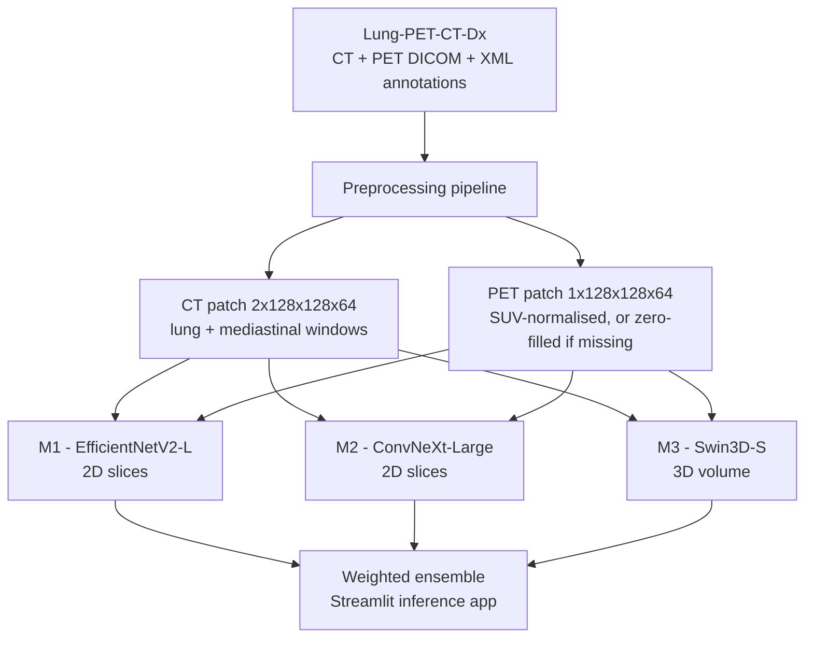

# A Comparative Evaluation of 2D and 3D Multimodal Deep Learning for Lung Cancer Histology Classification


An MSc research project that trains and compares three multimodal deep-learning
architectures for **four-class lung-cancer histology classification** from CT and
PET imaging, under realistic constraints: **severe class imbalance**, **incomplete
PET availability**, and a **small single-source dataset**. The study compares two
2D slice-based models against one 3D volume-based model on identical data, and
reports **class-level and macro-averaged metrics** rather than accuracy alone.

**Author:** Teja Jaladi (Student ID K00327828)
**Supervisor:** Mr. Rakibul Sitab
**Programme:** MSc in Data Analytics, Technological University of the Shannon: Midlands Midwest
**Date:** August 2026

> **Research use only.** This is not a medical device and must not be used for
> clinical diagnosis, therapy selection, or any form of clinical decision-making.

---

## Overview

Lung cancer is not one disease but several histologically distinct subtypes, and
identifying the subtype is a first step in treatment planning. Biopsy remains the
gold standard, but it is invasive and not always feasible. CT captures tumour
structure while PET captures metabolic activity, so the two modalities provide
complementary evidence for a non-invasive approach.

This project builds a reproducible framework to answer: *how effective are
multimodal deep-learning models at lung-cancer histology classification when data
is imbalanced and validation is limited?* Three models (M1, M2, M3) are trained on
the same prepared CT/PET data, evaluated with a patient-level holdout for the
three common classes and a leave-one-out scheme for the rare large-cell class, and
compared honestly on a class-by-class basis.

## Key Results

**ABG patient-level holdout** (adenocarcinoma / small-cell / squamous; n = 54 patients):

| Model | Accuracy | Precision | Recall | Macro F1 | Macro AUC |
|-------|---------:|----------:|-------:|---------:|----------:|
| M1 (EfficientNetV2-L, 2D) | **0.7222** | 0.5723 | 0.3667 | 0.3390 | 0.6458 |
| M2 (ConvNeXt-Large, 2D) | 0.7037 | 0.5558 | **0.5006** | **0.5178** | **0.7359** |
| M3 (Swin3D-S, 3D) | 0.7037 | 0.4038 | 0.3579 | 0.3296 | 0.5078 |

**LCC-inclusive 5-fold LOOCV** (all four classes; mean ± SD). Note M1/M2 use 55
patients per fold while M3 uses 74 records per fold (including augmentation-derived
large-cell records), so these figures are not strictly like-for-like:

| Model | Accuracy | Macro F1 | Macro AUC |
|-------|---------:|---------:|----------:|
| M1 | 0.7055 ± 0.0136 | 0.2629 ± 0.0175 | 0.6355 ± 0.0719 |
| M2 | 0.6836 ± 0.0337 | 0.3056 ± 0.0229 | 0.7174 ± 0.0545 |
| M3 | **0.7378 ± 0.0388** | **0.5640 ± 0.0130** | **0.8202 ± 0.0181** |

**Class-level detail (ABG).** The headline accuracy masks uneven per-class
behaviour, which is the central finding:

| Class | M1 (P / R / F1) | M2 (P / R / F1) | M3 (P / R / F1) |
|-------|-----------------|-----------------|-----------------|
| Adenocarcinoma (n=38) | 0.72 / 1.00 / 0.84 | 0.77 / 0.87 / 0.81 | 0.71 / 0.97 / 0.82 |
| Small-cell carcinoma (n=6) | 0.00 / 0.00 / 0.00 | 0.40 / 0.33 / 0.36 | 0.00 / 0.00 / 0.00 |
| Squamous-cell carcinoma (n=10) | 1.00 / 0.10 / 0.18 | 0.50 / 0.30 / 0.38 | 0.50 / 0.10 / 0.17 |

**Takeaways**

- **Accuracy alone is misleading under imbalance.** M1 has the highest ABG
  accuracy but **zero recall on small-cell carcinoma**, a majority-class bias that
  accuracy hides completely.
- **Which model "wins" depends on the metric.** M1 leads on raw accuracy, M2 on
  balanced ABG performance (macro recall/F1/AUC), M3 on its own LCC-inclusive
  record-level protocol (where every model was tuned separately by protocol).
- **No single model is superior on all dimensions.** The 3D advantage for M3 is
  consistent with, but does not conclusively prove, a benefit of volumetric
  modelling, because dimensionality, backbone family, fusion strategy and
  modality handling all vary at once.

## Models

| Model | Backbone | Dimensionality | Key design | Checkpoint |
|-------|----------|----------------|------------|------------|
| **M1** | EfficientNetV2-L (`tf_efficientnetv2_l.in21k_ft_in1k`) | 2D slices | Occupancy-ranked slice selection, binary PET-availability flag, weighted cross-entropy, top-k confidence aggregation, flip TTA | [HF ↗](https://huggingface.co/tejajaladi/lung-cancer-effnetv2l-m1-e-loocv-v8-hybrid) |
| **M2** | ConvNeXt-Large (`convnext_large.fb_in22k_ft_in1k`) | 2D slices | Learned PET-availability embedding, PET-aware slice ranking, hybrid focal loss, weighted sampler, gradient checkpointing | [HF ↗](https://huggingface.co/tejajaladi/lung-cancer-convnext-large-m2-e-loocv-v9-stable) |
| **M3** | Swin3D-S | 3D volume | Full tumour-centred volume, focal loss, label smoothing, mixup, weighted sampler, minority-class specialist policy, four-view TTA, gradient accumulation/checkpointing | [HF ↗](https://huggingface.co/tejajaladi/lung-cancer-swin3ds-m3-MINT-LOOCV-Aggregate-v7) |

- **M1** ranks axial slices by CT occupancy, keeps the top 24 (train) / 48 (eval)
  slices, and averages the logits of the 12 most confident slices into a
  patient-level prediction. Image size 224, batch 48, 8 warm-up + up to 22 epochs.
- **M2** scores each slice as `0.70·occupancy + 0.15·texture + 0.15·PET`, keeps the
  top 32, and forms the patient logit as `0.75·(top-8 mean) + 0.25·(all-slice mean)`.
  Its modality embedding encodes three states: zero-filled PET, real PET, and
  augmentation-derived record. Image size 224, batch 8, 3 warm-up + up to 14 epochs.
- **M3** rearranges the volume from `3×128×128×64` to `3×64×128×128`, z-score
  normalises each channel independently, and trains with focal loss (γ=3.0), label
  smoothing 0.10, mixup 0.25, gradient accumulation 4 and gradient checkpointing.
  Batch 2, 5 warm-up + up to 45 epochs. A separate specialist policy trains the
  non-adenocarcinoma classes with more minority-focused settings.

## Pipeline



## Dataset and Preprocessing

**Source:** [TCIA Lung-PET-CT-Dx](https://www.cancerimagingarchive.net/collection/lung-pet-ct-dx/)
(Li et al., 2020) — 355 de-identified patients with CT / PET-CT DICOM and XML
lesion annotations, accessed via a Kaggle-hosted mirror. Histology is encoded in
the patient-ID prefix:

| Prefix | Class |
|--------|-------|
| A | Adenocarcinoma |
| B | Small-cell carcinoma |
| E | Large-cell carcinoma |
| G | Squamous-cell carcinoma |

**Prepared four-class dataset** (n = 455 records). Large-cell carcinoma records
include 20× augmentation of 5 real patients; the other classes are unaugmented, so
their record and patient counts match:

| Class | Records |
|-------|--------:|
| Adenocarcinoma | 251 |
| Large-cell carcinoma | 105 (5 real patients × 20) |
| Small-cell carcinoma | 38 |
| Squamous-cell carcinoma | 61 |
| **Total** | **455** |

**Preprocessing steps** (`Automated_Pipeline/`):

1. Ingest DICOM series, reject non-diagnostic series (scout / topogram), sort slices.
2. Parse XML bounding boxes into a lesion centre to guide patch extraction
   (falling back to volume-centre when unavailable).
3. CT dual-windowing into two channels — lung (−1000…−200 HU) and mediastinal
   (−175…225 HU) — clipped and rescaled.
4. PET SUV representation where dose/weight metadata exists, otherwise intensity
   fallback; a **zero-filled placeholder** is used when PET is entirely missing.
5. Extract fixed-size, tumour-centred patches and write a patient manifest plus
   train/val/test and LOOCV split files.

**Data conventions / input contract**

| Tensor | Shape | Notes |
|--------|-------|-------|
| CT patch | `(2, 128, 128, 64)` | channel 0 lung window, channel 1 mediastinal window |
| PET patch | `(1, 128, 128, 64)` | SUV-normalised, or all zeros when PET is unavailable |
| Combined volume | `(3, 128, 128, 64)` | CT + PET stacked on the channel axis |
| M1 / M2 slice | `(3, 224, 224)` | 2D input after slice selection |
| M3 volume tensor | `(3, 64, 128, 128)` | depth-major layout expected by Swin3D |

Label order used by the classifier: `[Adenocarcinoma, Small Cell, Squamous, Large Cell]`.

## Repository Structure

```
data_processing/
├── Tciad-processing/                                    # Raw DICOM inspection + metadata extraction
├── Automated_Pipeline/                                  # DICOM → patches + manifest + splits
├── Model_Training/                                      # Dataset verification / training-readiness checks
├── Cancer_EDA/                                          # Exploratory data analysis + Word report
├── Lung Cancer Classification Using EfficientNet-B0/    # 2D classification training notebook
├── Predictrion_App/                                     # Streamlit ensemble inference application
└── README.md
```

| File | Role |
|------|------|
| [tciad-processing.py](file:///c:/Users/tejaj/Documents/New%20folder/data_processing/Tciad-processing/tciad-processing.py) | Reads DICOM series with `pydicom`, prints metadata, renders sample slices, builds per-file pixel statistics and writes `dicom_metadata.csv`. |
| [automated-multimodal-ct-pet-preprocessing-pipeline.py](file:///c:/Users/tejaj/Documents/New%20folder/data_processing/Automated_Pipeline/automated-multimodal-ct-pet-preprocessing-pipeline.py) | End-to-end preprocessing: dual-windowed CT, SUV PET, tumour-centred patches, 20× large-cell augmentation, manifest, ABG split and LOOCV folds. |
| [model_training.py](file:///c:/Users/tejaj/Documents/New%20folder/data_processing/Model_Training/model_training.py) | Validates the prepared dataset: file counts, patch shapes/ranges, NaN/Inf checks, LOOCV fold validity, clinical coverage and a DataLoader simulation. |
| [cancer-eda.py](file:///c:/Users/tejaj/Documents/New%20folder/data_processing/Cancer_EDA/cancer-eda.py) | Exploratory analysis: class distribution, PET availability, split composition, clinical and imaging plots, exported to `part5_EDA_report.docx`. |
| [lung-cancer-classification-using-efficientnet-b0.py](file:///c:/Users/tejaj/Documents/New%20folder/data_processing/Lung%20Cancer%20Classification%20Using%20EfficientNet-B0/lung-cancer-classification-using-efficientnet-b0.py) | 2D transfer-learning classification notebook (two-stage warm-up + fine-tuning) with imbalance-aware loss and LOOCV for the rare class. |
| [lung-cancer-prediction-app.py](file:///c:/Users/tejaj/Documents/New%20folder/data_processing/Predictrion_App/lung-cancer-prediction-app.py) | Builds and launches the Streamlit ensemble app; downloads M1/M2/M3 checkpoints and combines their probabilities with user-set weights. |

## Tech Stack

| Stage | Tools |
|-------|-------|
| Framework | PyTorch, torchvision |
| Backbones / weights | timm (`tf_efficientnetv2_l.in21k_ft_in1k`, `convnext_large.fb_in22k_ft_in1k`, Swin3D-S) |
| Data & imaging | NumPy, pandas, pydicom, Pillow, matplotlib, openpyxl |
| Metrics | scikit-learn, SciPy |
| Checkpoint storage | Hugging Face Hub, safetensors |
| Demo interface | Streamlit |
| Compute | Kaggle Notebooks (GPU) for preprocessing; NVIDIA A100 40 GB (16 vCPU, 112 GB RAM) for fine-tuning |

## Getting Started

**Install dependencies** (pinned versions follow the training scripts):

```bash
pip install torch torchvision timm==1.0.27 huggingface_hub==0.23.5 safetensors==0.4.5 \
    numpy==1.26.4 pandas==2.2.2 scikit-learn==1.5.1 scipy==1.14.1 Pillow==10.4.0 \
    streamlit pydicom matplotlib openpyxl python-docx
```

**Provide your Hugging Face token** (never commit it):

```powershell
$env:HF_TOKEN = "<your-token>"
```

**Run the pipeline** (preprocessing expects Kaggle-style input paths; update the
path constants when running elsewhere):

```bash
# 1. Preprocess DICOM -> patches + manifest + splits
python Automated_Pipeline/automated-multimodal-ct-pet-preprocessing-pipeline.py

# 2. Verify the prepared dataset is training-ready
python Model_Training/model_training.py

# 3. Generate the EDA report
python Cancer_EDA/cancer-eda.py

# 4. Launch the ensemble inference app
python Predictrion_App/lung-cancer-prediction-app.py
```

The inference app validates input shapes (CT `2×128×128×64`, PET `1×128×128×64`),
runs M1/M2/M3, and returns the ensemble probability
`P_final = (w1·P_M1 + w2·P_M2 + w3·P_M3) / (w1 + w2 + w3)`.

## Reproducibility

- Random seeds are set for Python, NumPy and PyTorch; configuration values,
  checkpoints and training logs are recorded.
- Core library versions are pinned (above) and trained checkpoints are versioned
  on the Hugging Face Hub, so any run can be reloaded unambiguously.
- Documented caveat: M1/M2 set `cudnn.benchmark = True` while M3 sets
  `cudnn.deterministic = True`, so results are not uniformly bit-for-bit
  reproducible across the three models.
- Each model was trained once with a single seed; no confidence intervals or
  significance tests are reported.

## Limitations and Ethical Notes

- **Single-source, retrospective evaluation** — no external multi-centre cohort,
  prospective trial, or calibration study; reported values are not real-world
  clinical accuracy.
- **Class imbalance and small sample** — small-cell carcinoma is severely
  under-represented (6 test patients), limiting minority-class confidence.
- **Confounded comparison** — M3 varies dimensionality, backbone family, fusion
  strategy and modality handling at once, so its advantage cannot be attributed to
  3D modelling alone.
- **No modality ablation** — CT-only / PET-only baselines were not run, so the
  individual PET contribution is not isolated.
- **M3 LCC protocol** — its LCC-inclusive results are record-level and include
  augmentation-derived records of the held-out case, so they are not directly
  comparable to the patient-level M1/M2 results.
- **No interpretability** — no saliency or attention maps; whether models attend to
  clinically plausible tumour regions is untested.
- **Not a medical device** — no regulatory review, no deployment, no clinical use.

## Citation

If you reference this work:

```
Jaladi, T. (2026). A Comparative Evaluation of 2D and 3D Multimodal Deep Learning
for Lung Cancer Histology Classification. MSc thesis, Technological University of
the Shannon: Midlands Midwest.
```

Dataset: Li, P., Wang, S., Li, T., Lu, J., HuangFu, Y. and Wang, D. (2020).
*A large-scale CT and PET/CT dataset for lung cancer diagnosis (Lung-PET-CT-Dx)*.
The Cancer Imaging Archive. https://doi.org/10.7937/TCIA.2020.NNC2-0461

## Contact

**Teja Jaladi** — MSc Data Analytics, Technological University of the Shannon.
Hugging Face: https://huggingface.co/tejajaladi
